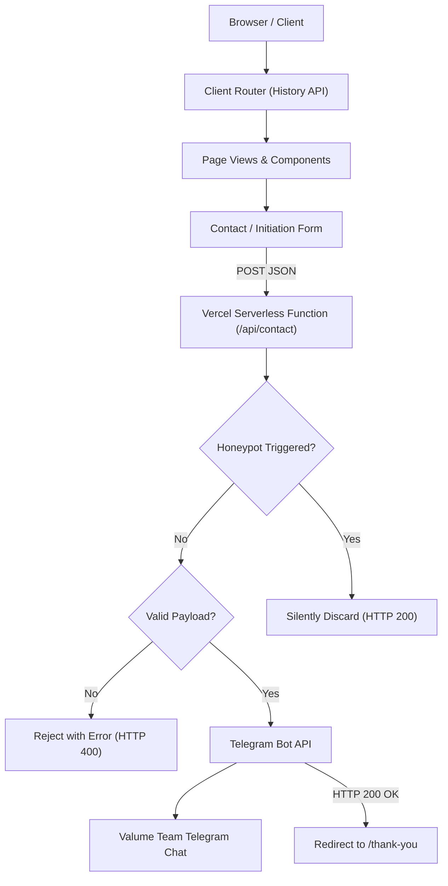

# Valume

This repository contains the production source code for the **Valume** website ([valume.studio](https://valume.studio/)).

> Most businesses don't need more tools. They need better systems.

Valume is a digital systems agency that designs and builds lead generation systems, business automations, digital products, and custom software for businesses. The site is designed with a dark editorial, kinetic studio, and commercial technology visual identity.

---

## What This Project Is

This repository contains the complete frontend application, service-specific pages, project exhibits, and serverless lead intake backend for Valume. 

The studio focuses on four core disciplines:

1. **Lead Generation Systems** — Architecture designed to capture, organize, qualify, and route commercial inquiries across multiple channels so opportunities are not lost between initial contact and follow-up.
2. **Business Automation** — Tailored automation workflows that eliminate repetitive operational overhead, consolidate communication, and streamline scheduling without disrupting business processes.
3. **Digital Products** — Customer portals, web applications, and interactive software modules designed around recurring operational workflows and digital assets.
4. **Custom Software** — Purpose-built web applications, internal dashboards, and API integrations engineered around how a company actually operates when off-the-shelf software falls short.

---

## Website

The application is structured into the following public and system routes:

### Public Indexable Routes

- **`/`** — Studio homepage featuring the core thesis, point of view, service overview, featured systems, operational methodology, and project initiation form.
- **`/lead-generation`** — Dedicated service breakdown on acquisition architecture, multi-channel capture, qualification gates, and human handoff routing.
- **`/business-automation`** — In-depth overview of operational automation, system bottlenecks, and criteria for custom workflow engineering.
- **`/digital-products`** — Architectural breakdown of client portals, self-serve tooling, and modular product engineering.
- **`/custom-software`** — Comprehensive overview of internal management systems, operational dashboards, APIs, and custom database development.
- **`/work`** — Index of production systems, internal prototypes, and active studio R&D.
- **`/contact`** — Direct commercial intake briefing form for starting a project.

### Post-Submission & System Routes

- **`/thank-you`** — Post-submission confirmation page displayed immediately after a successful inquiry. Intentionally tagged with `noindex, nofollow` and excluded from `sitemap.xml`.
- **404 Fallback** — Fallback page for unmatched coordinates, providing an immediate path back to the studio homepage.

---

## Work

The `/work` route showcases real projects, prototypes, and laboratory research developed by Valume:

### QR Review Engine
A streamlined customer review system designed for hospitality and physical venues.
- **Workflow:** `SCAN → RATE → GENERATE → EDIT → COPY → GOOGLE REVIEW`
- **Customer Control:** Customers rate their experience, review an editable draft, copy the text to their clipboard, and manually post the review on Google Maps themselves. The system does *not* automatically post reviews to third-party platforms.

### Lead Generation System
An internal operational prototype demonstrating an end-to-end outbound acquisition pipeline:
- **Pipeline Architecture:** `Lead Research → Lead Database → Qualification Gate → Targeted Outreach → Reply Detection → Human Handoff`
- Labeled explicitly as a **Valume Internal Prototype** to distinguish internal R&D from client engagements.

### Valume Lab
The studio's internal digital product incubator and experimentation space for developing reusable modular codebases, internal utilities, and software components.

---

## Tech Stack

The project uses a focused modern web stack:

- **React 19** (`react`, `react-dom`) — Component-driven declarative UI runtime.
- **TypeScript 5** (`typescript`) — Strict type safety across client interfaces, routing state, and serverless API handlers.
- **Vite 6** (`vite`) — Modern build tool with fast Hot Module Replacement (HMR) and optimized Rollup production bundling.
- **Tailwind CSS 3** (`tailwindcss`) — Utility-first styling framework configured for Valume's dark editorial palette (`#0B0B0B` Ink, `#F1EEE7` Bone, `#FF4D2E` Signal Orange).
- **Motion** (`motion`) — Restrained, kinetic animation system providing editorial entrances, scroll reveal steps, and ambient hairline sweeps.
- **Lucide React** (`lucide-react`) — Minimal iconography set for system nodes, status markers, and interface controls.
- **Vercel** — Production hosting platform providing global CDN edge delivery and serverless function execution.
- **Telegram Bot API** — Lightweight, serverless delivery mechanism for real-time internal lead intake notifications.

---

## Architecture



### Key Architectural Characteristics
- **Client Routing & Scroll Restoration:** Custom history router in `src/router/Router.tsx` managing instantaneous transitions without unwanted page reloads, accompanied by instant scroll position reset (`window.scrollTo({ top: 0, left: 0, behavior: 'instant' })`) and preserved programmatic section scrolling (`#thesis`, `#process`).
- **Edge Rewrites:** `vercel.json` configures single-page application rewrites to `/index.html` while strictly preserving serverless function endpoints under `/api/(.*)`.
- **Serverless API:** Lightweight endpoint in `api/contact.ts` handling payload parsing, streaming DoS size limits, strict validation, and Telegram Bot API notification dispatch.

---

## Contact Form

The project inquiry system (`/contact` and the homepage Initiation section) provides a streamlined briefing workflow:

- **Form Fields:**
  - `01 — PROJECT TYPE`: Choice between *Lead Generation*, *Business Automation*, *Digital Product*, or *Custom Software*.
  - `02 — YOUR NAME`: Text input (2–100 characters).
  - `03 — WORK EMAIL`: Email input with regex verification.
  - `04 — PHONE / WHATSAPP`: Optional telephone/messaging field (`type="tel"`) for direct communication.
  - `05 — OBJECTIVE`: Textarea capturing what the client is trying to build or fix (5–3,000 characters).
- **Honeypot Anti-Spam Protection:** A hidden input field (`hp_field`) traps automated bots without burdening users with CAPTCHAs. Bot submissions are silently acknowledged with HTTP 200 and discarded.
- **Server-Side Validation:** Validates field existence, types, string length bounds, and email formatting before any notification is dispatched.
- **Failure Resilience:** In the event of a network or delivery failure, client state is preserved so inputs are not lost. Error messages are sanitized to prevent internal server details from leaking.

---

## Source Tracking

The application automatically captures acquisition channels via query parameter tracking implemented in `src/utils/source.ts`:

| Query Parameter | Detected Source |
| :--- | :--- |
| `?source=instagram` | `Instagram` |
| `?source=linkedin` | `LinkedIn` |
| `?source=outreach` | `Outreach` |
| `?source=twitter` or `?source=x` | `Twitter` |
| `?source=<custom>` | Capitalized custom string |
| *(None provided)* | `Website` (Default Fallback) |

The resolved traffic source is included in the internal Telegram briefing alert.

---

## Environment Variables

Internal lead notifications require Telegram Bot credentials configured on the server. These variables are never exposed to the client bundle:

```env
# Server-side only (never prefix with VITE_)
TELEGRAM_BOT_TOKEN=your_telegram_bot_token_here
TELEGRAM_CHAT_ID=your_numeric_chat_id_here
```

- **Local Development:** Place values in a local `.env` file in the project root. (Git-ignored by default).
- **Production (Vercel):** Add `TELEGRAM_BOT_TOKEN` and `TELEGRAM_CHAT_ID` under **Project Settings → Environment Variables**.

---

## Development & Build

### Prerequisites
- Node.js (v18+ recommended)
- npm (v9+)

### Installation
```bash
npm install
```

### Local Development
Starts the local development server at `http://localhost:5173`:
```bash
npm run dev
```

### Production Build
Type-checks the codebase using TypeScript and generates minified bundles in `dist/`:
```bash
npm run build
```

### Production Preview
Locally serves the compiled `dist/` directory:
```bash
npm run preview
```
